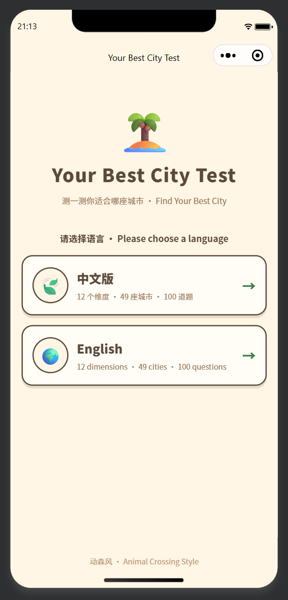
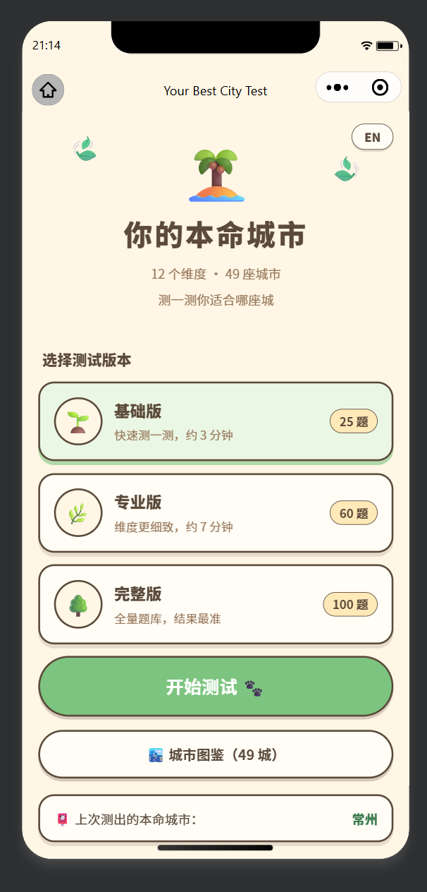
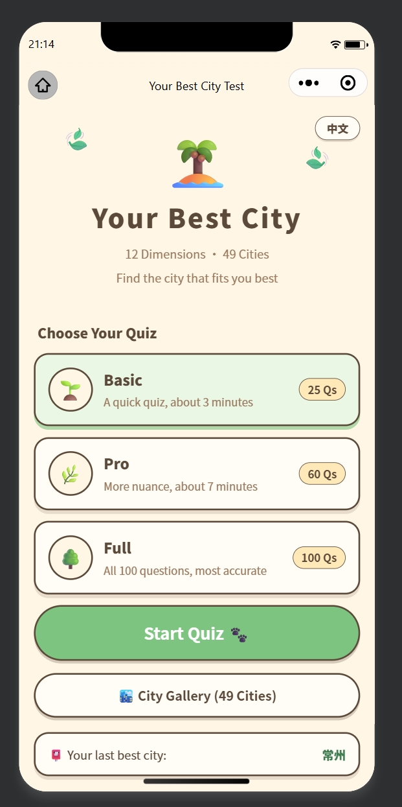

# Your Best City Test · 你的本命城市测试

[English](#english) | [中文](#中文)

***

<a id="english"></a>

## 🏝️ Your Best City Test

> A WeChat Mini Program that finds the Chinese city you were meant to live in — Animal Crossing style.

**Your Best City Test** is a personality-quiz Mini Program. Answer questions about your lifestyle, and it matches you against **49 Chinese cities** across **12 life dimensions**, then serves you a shareable result card, a 12-dimension match report, and a mini travel guide for your best city.

### 📱 Screenshots

| Language Picker | Home (中文) | Home (English) |
|:---:|:---:|:---:|
|  |  |  |

### ✨ Features

* **49 cities, 12 dimensions** — 4 Tier-1, 15 New Tier-1, and 30 Tier-2 cities, each pre-scored 0–100 on: pace of life, social life, career growth, trends & ideas, history & culture, nature & outdoors, waterfront living, warm climate, food scene, refined living, global openness, and stability.

* **3 quiz versions** — Basic (25 questions), Pro (60), Full (100). Every question has 4 options; each option shifts 2–3 dimensions by an integer in \[-3, 3].

* **Smart matching** — your answers build a 12-dimension profile, matched against every city by dimension distance to produce a compatibility score and ranking.

* **Result card** — best city, compatibility score, standout traits, and top-3 runner-ups; share to chats / Moments, or save a hand-drawn-style card to your photo album (canvas 2D).

* **12-dimension match report** — \~200-character interpretation per dimension explaining how you and the city fit (user tendency + city character + gap analysis + practical advice).

* **City travel guide** — 5 must-visit spots with reasons and 4 local foods with exact locations for every city.

* **City gallery** — browse all 49 cities with covers, tier filters, and dimension charts.

* **Bilingual 中文 / English** — a language picker on launch, a *Welcome to China* screen for English users, and a fully translated 100-question quiz; scoring is identical across languages.

* **Animal Crossing UI** — cream backgrounds, chunky rounded cards, hard-shadow buttons, all in `rpx`.

### 🛠 Tech Stack

* WeChat Mini Program (native), **TypeScript + SCSS**

* No backend — all data and matching run locally on device

### 📁 Project Structure

```
├── miniprogram/
│   ├── app.json / app.ts / app.scss   # App config, global Animal Crossing styles
│   ├── data/
│   │   ├── dimensions.ts              # 12 dimension metadata (zh/en names, icons, colors)
│   │   ├── cities.ts                  # 49 cities × 12-dimension preset scores (0–100)
│   │   ├── questions.ts               # 100-question bank (zh) with dimension weights
│   │   ├── questionsEn.ts             # 100-question bank (en), 1:1 with the zh version
│   │   └── cityGuide.ts               # 5 spots + 4 foods with locations per city
│   ├── utils/
│   │   ├── match.ts                   # Profile vector + city matching algorithm
│   │   ├── report.ts                  # 12-dimension match report generator
│   │   └── i18n.ts                    # Language state + zh/en UI strings
│   └── pages/
│       ├── lang/                      # Language picker + Welcome to China screen
│       ├── index/                     # Home: quiz version selection
│       ├── quiz/                      # Quiz: progress, auto-advance, go back
│       ├── result/                    # Result: card, guide, report, share & save
│       └── cities/                    # City gallery with detail popups
├── project.config.json                # WeChat DevTools project config
├── tsconfig.json
└── logs/                              # Change logs (per project convention)
```

### 🚀 Getting Started

1. Install [WeChat DevTools](https://developers.weixin.qq.com/miniprogram/dev/devtools/download.html).
2. Open this directory as a Mini Program project (appid is pre-filled in `project.config.json`, or use a test appid).
3. Compile and run — the language picker appears first.

> **Note:** City covers are loaded from a remote OSS bucket (`zzz-pet.oss-cn-hangzhou.aliyuncs.com`). Add it as a legal `downloadFile` domain in the Mini Program console for real-device preview, or enable "Do not verify legal domains" in DevTools.

### 📊 Scoring Rules

* Each city has preset scores (0–100) for all 12 dimensions.

* Each option affects 2–3 dimensions with a weight in **\[-3, 3]** (negative pulls low, positive pulls high).

* Your profile starts at 50 per dimension; answer effects are normalized by quiz length so all three versions stay comparable.

* Compatibility = dimension-by-dimension distance between your profile and each city, ranked across all 49 cities.

### 🗺 Roadmap

* [ ] English content for match reports & city guides

* [ ] Long-image share card with full travel guide

* [ ] Result poster with city cover image

### 📄 License

MIT

***

<a id="中文"></a>

## 🏝️ 你的本命城市测试

> 一款动森风微信小程序：测一测你适合哪座中国城市。

**Your Best City Test** 是一款性格测试类小程序。回答关于生活方式的问题，它会把你与 **49 座中国城市** 在 **12 个生活维度** 上逐一匹配，最后生成可分享的结果卡片、12 维匹配报告，以及专属于你本命城市的迷你旅行攻略。

### 📱 应用截图

| 语言选择页 | 首页（中文版） | 首页（英文版） |
|:---:|:---:|:---:|
|  |  |  |

### ✨ 功能特性

* **49 城 × 12 维** —— 一线 4 座、新一线 15 座、二线 30 座，每城在生活节奏、社交活力、事业发展、新潮创意、历史人文、自然户外、滨水偏好、气候温暖、美食烟火、精致消费、国际开放、安稳宜居 12 个维度上预设 0～100 分。

* **三个测试版本** —— 基础版（25 题）、专业版（60 题）、完整版（100 题）。每题 4 个选项，每个选项影响 2～3 个维度，影响值为 \[-3, 3] 区间整数。

* **智能匹配** —— 答题生成 12 维个人画像，与每座城市逐维度计算距离，得出契合度评分与完整排名。

* **结果卡片** —— 本命城市、契合度、突出气质、Top3 备选；支持分享到聊天/朋友圈，或用 canvas 2D 绘制卡片保存到相册。

* **12 维匹配报告** —— 每个维度约 200 字解读：你的倾向 + 城市特点 + 差距分析 + 落地建议。

* **城市旅行攻略** —— 每城 5 处打卡点（附理由）+ 4 条美食推荐（附详细地点）。

* **城市图鉴** —— 49 城封面浏览、分层筛选、维度详情弹层。

* **中英双语** —— 启动语言选择页、英文版专属「Welcome to China」欢迎屏、100 道题完整英文版；两种语言评分逻辑完全一致。

* **动森风 UI** —— 奶油底色、圆角粗描边卡片、硬阴影按钮，全站使用 `rpx` 单位。

### 🛠 技术栈

* 微信原生小程序，**TypeScript + SCSS**

* 无后端 —— 全部数据与匹配计算均在本地完成

### 📁 项目结构

```
├── miniprogram/
│   ├── app.json / app.ts / app.scss   # 应用配置与全局动森风样式
│   ├── data/
│   │   ├── dimensions.ts              # 12 维度元数据（中英文名、图标、配色）
│   │   ├── cities.ts                  # 49 城 × 12 维预设评分（0～100）
│   │   ├── questions.ts               # 100 道中文题库（含维度权重）
│   │   ├── questionsEn.ts             # 100 道英文题库（与中文版一一对应）
│   │   └── cityGuide.ts               # 每城 5 处打卡点 + 4 条美食（附地点）
│   ├── utils/
│   │   ├── match.ts                   # 画像向量 + 城市匹配算法
│   │   ├── report.ts                  # 12 维匹配报告生成器
│   │   └── i18n.ts                    # 语言状态 + 中英文案表
│   └── pages/
│       ├── lang/                      # 语言选择页 + Welcome to China 欢迎屏
│       ├── index/                     # 首页：版本选择
│       ├── quiz/                      # 答题页：进度、自动跳题、回退
│       ├── result/                    # 结果页：卡片、攻略、报告、分享保存
│       └── cities/                    # 城市图鉴（含详情弹层）
├── project.config.json                # 微信开发者工具项目配置
├── tsconfig.json
└── logs/                              # 改动日志（项目约定）
```

### 🚀 快速开始

1. 安装 [微信开发者工具](https://developers.weixin.qq.com/miniprogram/dev/devtools/download.html)。
2. 以小程序项目打开本目录（`project.config.json` 已预填 appid，也可使用测试号）。
3. 编译运行 —— 首先出现语言选择页。

> **注意**：城市封面加载自远程 OSS（`zzz-pet.oss-cn-hangzhou.aliyuncs.com`）。真机预览需在小程序后台配置 downloadFile 合法域名，或在开发者工具中勾选「不校验合法域名」。

### 📊 评分规则

* 每座城市在 12 个维度上预设 0～100 分。

* 每个选项影响 2～3 个维度，权重为 **\[-3, 3]**（负分偏向低分方向，正分偏向高分方向）。

* 个人画像各维度从 50 分起步，答题影响按题量归一化，保证三个版本结果可比。

* 契合度 = 个人画像与每座城市逐维度距离，对 49 城统一排名。

### 🗺 路线图

* [ ] 匹配报告与城市攻略的英文内容

* [ ] 包含完整攻略的长图分享卡片

* [ ] 带城市封面的结果海报

### 📄 许可证

MIT
